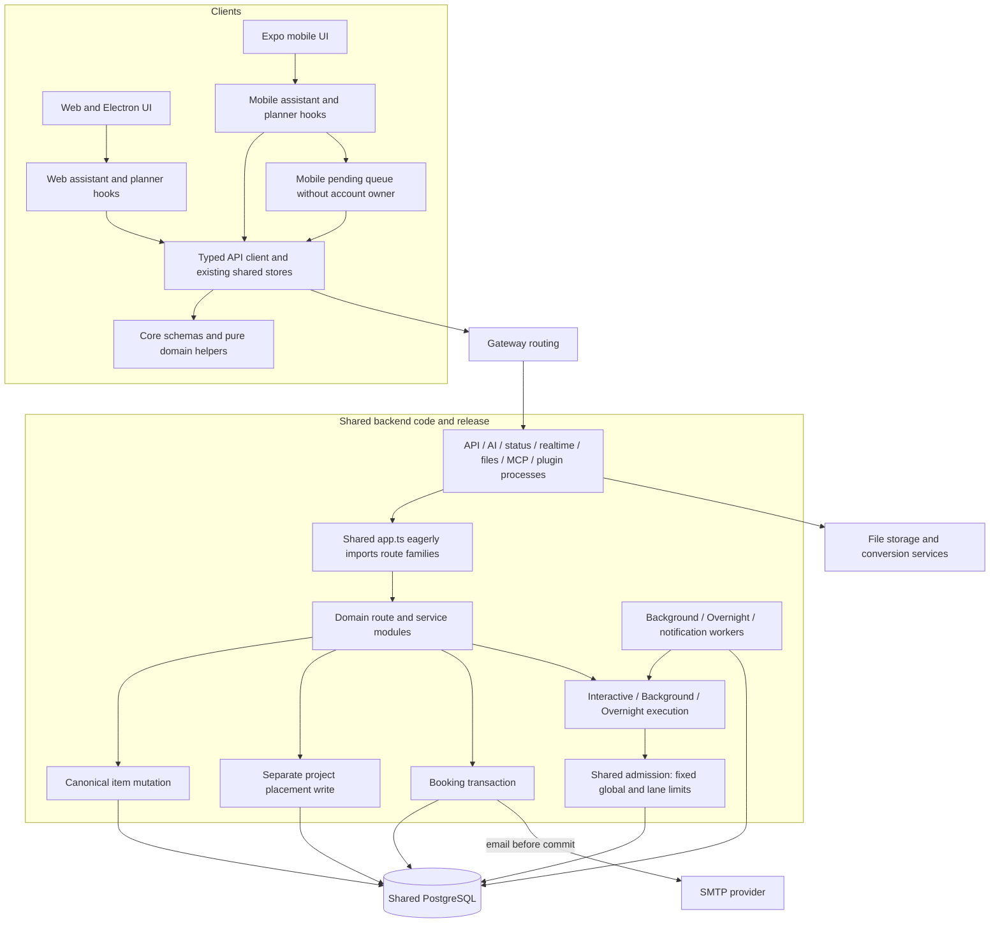
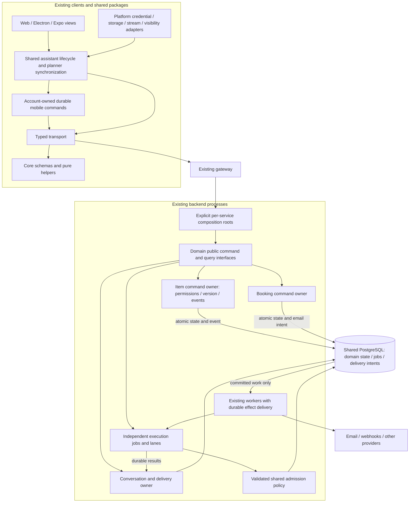
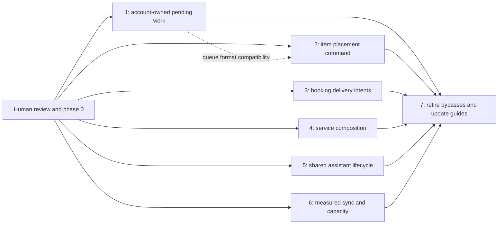

# Architecture consolidation: ownership, durable work and client state

**Status: ACCEPTED DIRECTION — local implementation and verification complete; release qualification remains open.**

Date: 26 October 2026 (Australia/Melbourne). Source baseline:
`9c5d75898e6aeeddeb9be813d98fb65088dbc1d5` on Orbyn `main`.

## Decision in plain language

Keep Orbyn's current stack and consolidate the ownership of changes and state.
The application is a modular monolith running across several processes, sharing
PostgreSQL and coordinated releases. That is a workable topology. The problems
identified here concern boundaries inside it: who may change an item, which
account owns pending work, when an external effect may happen, and which layer
owns the assistant lifecycle.

The proposed outcome is:

- Pending mobile changes can only run for the account that created them.
- Every item placement change follows one version, permission and event contract.
- Booking emails are requested durably with the booking change and sent after commit.
- Each server process imports the modules it actually serves.
- Web and mobile share assistant state transitions, while keeping their own UI
  and platform integrations.
- Planner refresh and assistant capacity become explicit, measurable policies.

This is an incremental consolidation. It does not require replacing Fastify,
PostgreSQL, React, Expo, the typed client or Orbyn's own assistant orchestration.
It does not introduce a message broker, separate databases or a package per feature.

## Scope and evidence limits

The preceding assessment traced backend entrypoints, domain writes, persistence,
workers, shared contracts, web/desktop and mobile clients, and deployment wiring.
It was a static source investigation, not an exhaustive correctness audit. No
production incident, load limit or observed runtime failure is established by this
ADR. File size and duplication alone are not defects.

This proposal covers the concrete findings below. It does not reopen the accepted
[ongoing assistant conversation decision](adr-unified-assistant-conversation.md),
enable its rollout flag, redesign the product UI, replace authentication, or claim
to fix every module. The current [architecture guide](../architecture.md),
[development guide](../development.md) and [operations guide](../operations.md)
continue to describe implemented behavior. This document describes proposed changes.

## Current topology

Arrows show dependencies and selected data flows, not every network route.
The server processes provide real execution isolation, but share source, database
ownership and a common composition module. Supporting conversion and file services
remain part of the deployment; they are not candidates for consolidation here.

### Findings that justify a change

Source links refer to the baseline above. They are evidence anchors, not new interfaces.

| Finding                                                         | Current source and mechanism                                                                                                                                                                                                                                                                                                                                                                                | Consequence and qualification                                                                                                                                                                                                                                                                                                                              |
| --------------------------------------------------------------- | ----------------------------------------------------------------------------------------------------------------------------------------------------------------------------------------------------------------------------------------------------------------------------------------------------------------------------------------------------------------------------------------------------------- | ---------------------------------------------------------------------------------------------------------------------------------------------------------------------------------------------------------------------------------------------------------------------------------------------------------------------------------------------------------- |
| Pending mobile work has no durable account owner                | [Mobile outbox](../../mobile/src/lib/outbox.ts) persists `orbyn-outbox-v1`; [entry schema](../../packages/core/src/outbox.ts) has no account identity. [Session reset](../../mobile/src/lib/session.ts) and automatic 401 handling in [planner lifecycle](../../mobile/src/hooks/usePlanner.ts) retain that queue. [API authentication](../../mobile/src/lib/api.ts) reads the current session token.       | A queued create from account A can be submitted under B after automatic session loss and a different login. Explicit sign-out already clears the queue; this finding concerns the automatic reset path. Backend authorization is still present.                                                                                                            |
| Project placement bypasses the canonical item mutation contract | `PUT /items/:id/project` in [project routes](../../backend/src/modules/projects/routes.ts) locks and updates the row directly. [projectAssign](../../packages/core/src/schemas.ts) lacks an expected version. [Item mutation](../../backend/src/modules/items/service.ts) checks the caller version and queues `item.updated`; [webhook queuing](../../backend/src/lib/webhooks.ts) also announces changes. | Placement can overwrite a newer placement without a caller-version conflict and omit the canonical notification path. The route has authorization and row locking; [project activity triggers](../../backend/migrations/049_project_activity.sql) also retain history. This is inconsistent mutation semantics, not an absence of access control or audit. |
| Booking email can precede database commit                       | [Booking routes](../../backend/src/modules/booking/routes.ts) invoke [booking services](../../backend/src/modules/booking/service.ts) inside [transaction callbacks](../../backend/src/db/pool.ts). Services await `mailBooker`, which calls [SMTP](../../backend/src/worker/channels/email.ts) and swallows delivery errors.                                                                               | Network work holds a transaction open; mail can succeed before a later commit fails. Failed delivery has no durable booking-email retry record. The existing behavior is best effort, so a stronger delivery promise needs an explicit contract.                                                                                                           |
| Process composition shares an eager import graph                | [app.ts](../../backend/src/app.ts) imports route families before selecting service modules; even the [status entrypoint](../../backend/src/services/status.ts) imports that composer.                                                                                                                                                                                                                       | Unrelated import-time failures can affect a process that does not serve those routes. Separate processes still isolate event loops and workloads. No startup or memory regression has been measured.                                                                                                                                                       |
| Assistant lifecycle decisions are repeated in clients           | [Web hook](../../desktop/src/hooks/useAssistant.ts) and [mobile hook](../../mobile/src/hooks/useAssistant.ts) separately handle waiting replies, retries, optimistic turns, generations and restoration. An account-aware [conversation store](../../packages/api-client/src/assistant-conversation-store.ts) already exists.                                                                               | Parallel implementations increase change and drift risk. Duplication does not prove current user-visible divergence. Platform UI, credentials and streaming adapters remain legitimate differences.                                                                                                                                                        |
| Planner refresh repeatedly reconstructs broad snapshots         | [Web planner](../../desktop/src/hooks/usePlanner.ts), [mobile planner](../../mobile/src/hooks/usePlanner.ts) and [listAllItems](../../packages/api-client/src/client.ts) fetch paginated collections and rebuild state on refresh.                                                                                                                                                                          | Work grows with account size. Existing ETags, coalescing, visibility rules and presence debounce help. Actual latency, request cost and the account size that requires a different design remain unmeasured.                                                                                                                                               |
| Assistant capacity is a fixed shared policy                     | [Lane limits](../../backend/src/modules/ai/agent/runtime-lanes.ts) are 4 interactive, 2 Background and 2 Overnight. [Slot reservation](../../backend/src/modules/ai/agent/runtime-slots.ts) coordinates a global cap of 8 across three work tables.                                                                                                                                                         | More replicas do not raise this global limit. It is also a deliberate provider and workload guard. Increasing concurrency without budget, fairness and provider evidence would weaken it.                                                                                                                                                                  |

### Foundations to preserve

Shared schemas and the typed client already provide useful contracts. The existing
[document store](../../packages/api-client/src/doc-editor-store.ts) and conversation
store demonstrate a viable shared application-state layer. Electron credentials
and native secure storage retain their separate platform boundaries.

The assistant already has durable jobs, leases, checkpoints, admission and current
authorization checks. Conversation delivery is distinct from execution ownership.
Background and Overnight must remain independent execution lanes; one ongoing user
conversation must not become one execution lock or one endless model call.
`ASSISTANT_CONVERSATION_ENABLED` remains disabled by default under this proposal.

PostgreSQL transactions and the existing transactional webhook outbox are useful
primitives to extend. Shared deployment artifacts and coordinated migrations remain
valid; this assessment did not establish a need for independent service releases.

## Proposed topology

New boxes below describe logical owners inside the existing repository and
processes. They do not imply new deployments, databases or packages.

### Ownership and dependency rules

| Owner                  | Owns                                                                                               | Boundary                                                                                                                                                                                           |
| ---------------------- | -------------------------------------------------------------------------------------------------- | -------------------------------------------------------------------------------------------------------------------------------------------------------------------------------------------------- |
| `packages/core`        | Shared wire schemas and pure domain helpers                                                        | Imports neither application code, transport nor platform APIs. Server authorization remains authoritative.                                                                                         |
| `packages/api-client`  | Typed transport and shared client lifecycle                                                        | Receives platform adapters. Does not import React, Expo, Electron or backend internals. Extend existing stores before adding a competing cache or retry loop.                                      |
| `desktop` and `mobile` | Rendering, navigation, platform integration and credential persistence                             | Consume shared contracts and stores; do not independently reinterpret shared lifecycle transitions.                                                                                                |
| Backend domain modules | Public commands, queries, permissions, transaction boundaries and durable effects for their domain | Other domains call the owning public interface instead of writing its tables. Item placement belongs to the item mutation owner; project membership and stage checks remain project-owned queries. |
| Service entrypoints    | Compose routes, dependencies, startup and shutdown                                                 | Import only their service graph. A combined development server may explicitly compose the union. Keep the shared image initially.                                                                  |
| Assistant execution    | Claims, leases, budgets, checkpoints and tools                                                     | Jobs retain independent identities and lane rules; results reach the conversation through delivery records with current access checks.                                                             |
| Workers and operations | Delivery, retries, admission configuration and operational recovery                                | Run committed intents with stable identities. Capacity changes cannot bypass global reservations or budget controls.                                                                               |

Do not start with a wholesale folder move. Prove each boundary through a complete
caller-to-storage path, migrate its callers, then remove the bypass. Add narrow
dependency enforcement using existing tooling where practical; an enforcement rule
is useful only if the real service and module graphs satisfy it.

## Phased plan

Owners below are implementation responsibilities, not requests to create new chats.
The user authorized phased implementation, starting with phase 1, on 26 October 2026. Acceptance checks below remain requirements until backed by the delivery
evidence recorded here. Phases 1–7 have local implementation and verification
evidence below. Deployment and native acceptance are not implied by local results.

### Phase 0 — Freeze the contract and baseline

**Outcome:** agree on scope and establish evidence before changing behavior.
The architecture lead and each affected domain/client owner reconcile this ADR
against the implementation revision, inventory callers and deployment versions,
and record existing latency, request volume, queue and admission metrics available.
Define representative small and large accounts without copying private user data.

**Complete when:** this ADR is accepted; queue ownership, mutation compatibility,
email delivery semantics and the first migration slice have named owners and
checkable contracts. Performance thresholds must be agreed from measurements and
product requirements rather than invented here.

**Recovery:** no data or behavior changes. Revise or reject the proposal.

### Phase 1 — Bind pending mobile work to its account

**Owners:** mobile session/outbox and shared outbox contract. **Depends on:** phase 0.

Persist an immutable authenticated account identifier with each new command, using
an owner-scoped queue format. Pause dispatch on session loss. Dispatch only when
the current account matches the command owner and current access still permits it.
Fence in-flight responses and storage updates with an account/session generation
so a late response cannot acknowledge or overwrite another session's queue.

The existing queue cannot supply a trustworthy historical owner. Quarantine legacy
entries for explicit recovery or discard; never assign them automatically to the
next login or silently delete them. Same-account reauthentication can resume
never-sent or definitively rejected owned entries after validation. Commands with
an unknown outcome require reconciliation if credentials changed or the server
receipt window expired. Keep logout semantics explicit and user-visible
where unsent work would be lost.

**Acceptance:** offline create → automatic 401 → different login sends nothing
from the earlier account; same-account reauthentication resumes safely; logout,
restart, concurrent flush, late acknowledgments and failed storage migration do
not lose or cross-acknowledge work. Legacy recovery has an explicit resolution path.

**Rollout/recovery:** version storage and migrate by copy then verified switch,
preserving recoverable entries. Block incompatible queue readers; a rollback may
pause sending, but must not restore the unowned dispatch path. Server authorization
remains the final guard, not a replacement for local ownership.

### Phase 2 — Establish one item placement command

**Owners:** items, projects, shared schemas and API callers. **Depends on:** phase 0;
reconcile pending-command compatibility with phase 1 before shipping either format.

Route placement through the item mutation owner with expected version, row lock,
current permissions, destination checks, version increment and canonical event in
one transaction. Reuse the existing webhook/live announcement mechanism. Inventory
web, mobile, MCP, plugin and automation callers rather than assuming the UI is the
only writer.

**Acceptance:** stale placement conflicts without overwriting; permission and
cross-team failures leave state unchanged; retries do not duplicate effects;
successful moves produce the expected version, activity and consumer notification.
All controlled callers use the same contract.

**Rollout/recovery:** introduce a versioned capability or bounded compatibility
window for installed clients. Explicitly document what an old request can do;
never treat a missing version as optimistic concurrency protection. Retire or
reject the old write path once supported clients migrate. Keep additive database
changes during rollout; rollback must not reintroduce an eventless writer.

### Phase 3 — Deliver booking email from committed intents

**Owners:** booking, notification worker and persistence. **Depends on:** phase 0.

Record the booking change and an email intent in the same transaction. Existing
workers deliver after commit using a stable event identity, booking revision and
durable status. Remove SMTP from the transaction. Define cancellation/reschedule
ordering so an obsolete confirmation cannot masquerade as the current booking.

**Acceptance:** rollback sends no email; SMTP latency holds no booking transaction;
known pre-send failures retry; worker crash/reclaim does not lose the intent;
reschedule/cancel ordering is represented correctly. Delivery status is inspectable.

**Rollout/recovery:** migrate additively and switch producer/sender ownership once;
never run the inline sender and outbox sender for the same event. Do not backfill
historical mail blindly. SMTP acceptance followed by a worker crash is ambiguous:
this design cannot promise exactly-once delivery. Record uncertain delivery and
use reconciliation rather than unconditional resend; use provider idempotency
only if the actual provider supports it. Rollback pauses delivery and retains
intents instead of returning network calls to transactions.

### Phase 4 — Make server composition explicit

**Owners:** service entrypoints, route owners and deployment. **Depends on:** phase 0.

Extract shared construction primitives without a global route import. Compose
each service from its required route owners, starting with the small status
service. Preserve route prefixes, authentication, plugin order, environment
validation, health checks and shutdown behavior. Keep the combined development
entrypoint explicit.

**Acceptance:** route inventory and gateway mapping are unchanged; the status
process no longer imports unrelated provider/domain route graphs; each process
starts and shuts down under its actual required configuration. Any claimed startup
or memory improvement requires before/after measurements.

**Rollout/recovery:** migrate one entrypoint at a time with the previous composer
available until parity is established. Revert the entrypoint independently; no
database migration or release independence is required.

### Phase 5 — Share the assistant lifecycle across clients

**Owners:** API-client stores and both client hooks. **Depends on:** phase 0.

Start with one bounded flow, such as answering a waiting question and restoring
the conversation after reconnect. Extend the existing conversation store or a
closely owned lifecycle module. Inject platform storage, clock, connectivity,
visibility and stream behavior; keep native and browser rendering separate.

**Acceptance:** both clients preserve stable attempt IDs, optimistic turns, draft
recovery, cancellation, sources and account-generation fences. Account switching,
late streams, interrupted replies, reconnect and process restart have equivalent
shared state semantics. Real native behavior requires native evidence; Expo web
alone cannot establish it.

**Rollout/recovery:** migrate a complete flow on both clients, then remove its
duplicated implementation. Continue in resumable slices without a second active
state owner. A switch back must preserve compatible persisted state and avoid
starting duplicate requests. Conversation rollout remains a separate decision.

### Phase 6 — Bound planner synchronization and assistant capacity

**Owners:** planner API/client stores, assistant runtime and operations.
**Depends on:** phase 0 measurements; reuse the established owner and account fences.
These are separate deliverable slices and need not ship together.

For planner data, inventory existing incremental query support before adding a new
protocol. Use bounded reads and targeted invalidation; define a stable cursor or
watermark contract with deletion, access revocation, pagination and resync behavior.
Retain a safe full-resync fallback. Partial companion-read failures must not erase
valid item state. Do not add a second cache merely to hide whole-snapshot reloads.

For assistant admission, retain the coordinated reservation and lane protections.
Move fixed limits to validated policy only after provider budgets and workload
needs are known. Define account/tenant fairness and starvation behavior before
raising concurrency. Persist the active policy revision under the admission owner
and check the writer's compatible revision atomically with slot reservation.
Reject incompatible claimers. Before activating this contract, stop or fence legacy
claimers that cannot perform that check; a revision field alone cannot fence them.
Allow existing jobs to drain under their leases while new claims obey the active
policy. This prevents old and new replicas from enforcing conflicting caps.

**Acceptance:** planner requests and convergence meet phase 0 thresholds under
large accounts, deletions, revoked access, duplicate/out-of-order events and
disconnects. Multiple runtime replicas preserve the global cap, lane isolation,
lease recovery and budgets; fairness meets an agreed workload requirement.

**Rollout/recovery:** retain compatible read contracts and resync for older clients.
Pause incremental use if convergence fails. Revert admission through coordinated
policy application: change the active revision atomically, reject stale writers
and drain excess work rather than killing unrelated jobs or allowing new claims
above the restored limit. No unbounded parallelism.

### Phase 7 — Retire bypasses and reconcile documentation

**Owners:** architecture lead and affected owners. **Depends on:** accepted evidence
for the preceding changes; no need to delay independent safe slices for this phase.

Remove unused writers, duplicated lifecycle transitions and compatibility paths
only after their callers and supported deployed versions are accounted for. Update
the maintained architecture, API, mobile, assistant and operations guides with
implemented behavior. Record evidence against the exact delivery candidate.

**Complete when:** there is one active owner per migrated contract, supported
clients and workers use it, recovery is documented, and remaining exceptions have
an explicit reason. A merged PR is not deployed adoption or user acceptance.

## Sequencing and delivery boundaries

Start with phase 1 because it concerns account ownership. Then prioritize the
item and booking correctness paths. Composition and shared lifecycle can follow
independently with bounded ownership; capacity changes wait for evidence.
Implementation work should use coherent reviewable slices, not one repository-wide
rewrite. Phases are dependency boundaries, not mandatory new sessions or a fixed PR count.

For every future slice, report local changes, verification, commit, CI, merge,
deployment and acceptance separately. Database, queue and installed-client
migrations need explicit mixed-version checks and recovery before deployment.

## Alternatives and trade-offs

| Option                                                           | Benefit                                                                                       | Cost / reason for selection                                                                                                                                                                                      |
| ---------------------------------------------------------------- | --------------------------------------------------------------------------------------------- | ---------------------------------------------------------------------------------------------------------------------------------------------------------------------------------------------------------------- |
| Leave architecture unchanged; patch individual symptoms          | Lowest immediate coordination cost                                                            | Leaves multiple writers and state owners available for the same failures to recur. Useful for urgent containment, insufficient as the complete direction.                                                        |
| Consolidate ownership inside the existing topology — proposed    | Reuses transactions, stores, typed contracts and operations; can ship one safe path at a time | Requires caller migration and compatibility discipline. Shared database and coordinated releases remain operational coupling.                                                                                    |
| Extract independent microservices, databases and a broker now    | Could provide independent deployment and scaling for proven boundaries                        | Adds distributed consistency, delivery and operations work before those boundaries are established. Current evidence does not justify that investment. Reconsider if measured workloads or ownership require it. |
| Merge all clients or all assistant work into one runtime/session | Appears to reduce duplicate code                                                              | Erases necessary platform, authorization and execution isolation. Share lifecycle contracts while preserving these boundaries.                                                                                   |

## Decisions to settle within the relevant implementation phase

The direction and phase 1 start are authorized. These details must be settled
before the relevant migration or rollout:

1. Whether ownership consolidation within the current stack is the intended scope.
2. Whether account-owned pending work is the first implementation slice, including
   quarantine and explicit recovery for legacy entries.
3. The supported installed-client compatibility window for item placement changes.
4. Booking email semantics: durable best effort with visible uncertain delivery,
   without an unsupported exactly-once promise.
5. Which measurements and workload targets gate phase 6; no concurrency increase
   or scale claim is approved merely by accepting this architecture.

**Next action:** finish phase 1 verification and recovery qualification, then
continue with the remaining phases in dependency order. Publication and deployment
remain separate from local implementation authority.

## Phase 1 implementation record

Local implementation is on `docs/architecture-consolidation`, based on the source
baseline above. This record describes an uncommitted candidate, not a deployment.

- New commands carry immutable `owner_id` and are persisted before sending.
  Selection, overlays, coalescing and user resolution use the active account only.
- Session persistence stores the opaque token and server-confirmed user ID together.
  Legacy raw tokens must establish identity through `/me`; cached profiles cannot
  establish it. Session invalidation and generation notifications are synchronous.
- Replay uses an account/session-bound client, checks before follow-up requests and
  actual transport retries, and rejects stale acknowledgments and UI actions.
  Guarded writes notify the planner client to preserve primary read consistency
  and prevent joining a read that started before the write.
- Logout retains unsent work for its owner. Sync details allow explicit discard,
  explaining that a request already accepted by the server cannot be undone locally.
- Migration writes a complete v2 recovery envelope and verifies its bytes before
  replacing the old v1 array with a non-array marker. Unknown future formats block
  sending without overwrite. Unowned or malformed payloads are held outside normal
  overlays and sending, with explicitly confirmed copy/discard controls.
- Recovery copies remain intact when storage fails. Reservations prevent page
  coalescing during persistence and dispatch; durable attempt metadata prevents
  coalescing after an ambiguous response, including across restart.
- The server's current receipts are scoped to credentials and retained for 24 hours.
  The queue records a credential fingerprint and attempt time before a write. It
  holds uncertain outcomes after a credential change or a conservative 23-hour
  retry window; explicit retry warns that the change may already exist. It does
  not store the credential itself in AsyncStorage. A definite rejection can resume
  after reauthentication. An in-progress receipt never triggers a fresh merge key.
- Session persistence failures remain visible for their owning generation. Failed
  local sign-out pauses dispatch and retains a retry path instead of reporting
  successful credential deletion. Browser credential-storage errors also propagate.

### Rollout and rollback contract

The active writer is the new mobile outbox plus the new session module. Its format
is `orbyn-outbox-v2` version 2; the session envelope is version 1 at the existing
credential-storage key. Both must ship together with their planner and Sync UI.
No server wire protocol or database schema changes are required for this phase.
The server receipt namespace and expiry remain unchanged; uncertain work is held
for reconciliation rather than assuming cross-credential deduplication.

The v1 marker prevents the historical array loader from reading migrated payloads.
It does **not** fence an already running older binary/tab with an in-memory queue,
or prevent an old binary from creating fresh unowned work. An arbitrary downgrade
is unsupported. A safe rollback build must retain the new ownership, generation,
quarantine and session-format behavior; it may disable dispatch while preserving
all saved work, including immutable attempted payloads and credential/receipt-window
guards. Before rollout, operations must close/replace legacy mobile-web
writers and select compatible native update/rollback builds. These deployment
controls have not been exercised by local tests.

### Verification boundary

Focused tests exercise actual outbox/session source with controlled storage and
request timing, the real typed transport with a denied-by-default fixture fetch,
and the affected planner/Sync callbacks. They cover account replacement,
reauthentication, late responses, compound commands, retries, storage failure,
interrupted migration, hidden legacy content and user-confirmed recovery.
Shared-package builds and mobile typechecking are local evidence. Native keychain,
AsyncStorage persistence across an installed-app update, clipboard behavior and
rendered mobile layouts still require device/renderer qualification before rollout.
No production data, credentials, provider calls or deployments are involved.

Local evidence so far: the historical `9c5d7589` outbox was executed in an isolated
fixture with synthetic credentials; the same retained command was submitted under
A and then B, confirming the regression control without a network call. The new
fixture uses the actual typed transport to check request credentials, retry fences,
primary-read headers and read coalescing. Additional tests model the backend's
credential-scoped receipt namespace and a lost response after commit. The audit
identified and drove fixes for pre-dispatch page coalescing, lost planner write
tracking, hidden session-storage failures and ambiguous replay; no hosted scan ran.

Remaining rollout work includes actual installed-device storage/update and
clipboard/layout checks, legacy writer shutdown, selection of a compatible
rollback build and deployed observation. These remain unverified, not implied by
passing local tests.

Phase 1 local checks (26 October 2026, before phase 2 integration): shared packages
built; mobile and desktop typechecks passed; 129 focused/adjacent tests passed;
6 PostgreSQL offline-sync tests passed against a separately created, marker-verified
`orbyn_test` database. Formatting, whitespace and current-guide links passed.
The final audit round identified a failed attempt-seal write bypass and a missing
uncertainty warning after a lost conflict-merge response. Both were corrected and
covered by passing regressions; those final corrections were self-verified, not
independently approved. Three bounded patch-review rounds are complete. This is
local evidence only, with installed-device and rollout gates still open.

Phase 2 caller discovery also found placement writes in project-unlink proposals
and post-create document/clip extraction. The implementation scope includes those
paths so that consolidating the REST route does not leave equivalent bypasses.
REST placement rejects versionless writes; controlled clients migrate together,
and older installed clients must update before moving tasks. On 26 October 2026
the user selected a 90-day exception for the published MCP `task_project` link
contract. Its deployment-wide deadline is persisted once, with content-free usage
accounting. During that window only, versionless MCP links use the locked task
version. At the deadline they fail with instructions to read and supply a version.
Explicit versions always retain conflict protection, including during the window.
Restarting or rerunning the migration must not extend the deadline. Deployment must
retire older server writers that cannot enforce this cutoff.

## Phase 2 implementation record (local implementation)

The REST placement endpoint now requires the item version and delegates to an
item-owned command using the canonical mutation and event path. Controlled web
and mobile callers send their displayed/detail version; two decision-to-task
flows set initial placement during creation instead of issuing a second move.
Conflict handling preserves the requested destination and refreshes for deliberate
retry without automatically replaying the stale choice.

Capability task/project links use the bounded MCP exception above. Newly produced
project-unlink proposals capture it; older versionless proposals remain readable
but require reproposal before application. Document/clip extraction sets placement
through initial creation so creation events describe the final item. The MCP
catalog and generated public tool references are regenerated from the registry.

The mobile causal queue also propagates an exact acknowledged creation version to
its subsequent unsent commands before persisting removal of the create. A placement
with no retained creation baseline is held for review instead of substituting a
freshly fetched current version. This is a phase 2 extension to the phase 1 queue;
its own regression checks are tracked separately.

Internal creation-option placement now validates and inserts the final placement
before its creation event. Project and stage deletion clear affected placement
through the item owner, preserving one version and canonical event per affected
item. New undo snapshots capture placement versions while holding the relevant
parent/task locks. Restoration requires the expected post-deletion version or a
trusted receipt from earlier steps in the same undo transaction. Legacy snapshots
restore their parents but skip placement without provenance, recording a
content-free audit count. A later deliberate unfile is preserved.

Local evidence includes 22 focused placement/undo tests, 123 adjacent PostgreSQL
snapshot/undo/project tests, 11 compatibility boundary/accounting tests, 7 client
callback tests, generated MCP catalog checks, and backend/client typechecks.
Overlapping batches are not additive unique-test counts. Source review preceded
the final compatibility and undo additions; those additions have focused local
test evidence. Large cascade latency is unbenchmarked. Competing item-first and
project-first locks can deadlock; PostgreSQL rolls back atomically, and no blanket
transaction retry was added. Installed old-client/old-server retirement remains
a deployment requirement.

## Phase 3 implementation record (local implementation)

Booking transitions save encrypted mail intents with a booking-local revision in
the same transaction. Initial address-verification mail is included and expires
with its advertised hold. The notifier claims committed intents, prepares them,
records dispatch, releases its transaction, and only then contacts SMTP. Newer
revisions supersede unsent older messages. Every message states the snapshot time
and revision because an SMTP exchange already in progress cannot be recalled.

Preparation failures and proven pre-submission failures may retry. Missing SMTP
configuration pauses work without consuming its retry budget. Expired sending
leases and ambiguous transport failures are held as uncertain; a stable Message-ID
does not establish provider idempotency. A bounded source review identified that
Nodemailer can report `ECONNECTION`/`CONN` after DATA submission; this combination
must therefore be uncertain, with a local transport regression covering it.

The additive migrations do not backfill historical mail. The existing Admin
retention mechanism keeps terminal receipts/encrypted payloads for 90 days by
default, configurable with a minimum of 7 days or 0 for indefinite retention.
Pending/in-flight work is excluded. Expiry and lease maintenance uses indexed
100-row batches; cutoffs use a stable statement timestamp for index range scans.
Operators can pause this lane with `BOOKING_EMAIL_DELIVERY_ENABLED=false` while
compatible producers continue recording intents. See [operations](../operations.md#booking-email-delivery).

Thirty local PostgreSQL/SMTP-fixture and adjacent booking/sweeper tests passed,
including a deferred commit failure, hold expiry, two workers, preparation races,
pause/retention, crash recovery and the installed transport's lost DATA response.
The loopback SMTP fixture uses synthetic mail only. Three bounded review rounds
are complete; the final source check found no new actionable defect after the
reported corrections. Reviewers inspected source and did not rerun the reported
tests. No real provider delivery or production deployment has been performed.

## Phase 4 implementation record (local implementation)

All seven HTTP entrypoints import their own ordered composition roots. `app.ts`
retains the explicit combined development/test union and compatibility exports.
The shared HTTP shell, environment validation, route prefixes, plugin order and
startup/shutdown machinery remain shared. Status's deployed import graph no
longer traverses unrelated domain route implementations. Other services retain
the transitive dependencies actually required by their registered routes.

Thirty composition/import/lifecycle unit checks and 29 PostgreSQL service,
route-inventory and plugin tests passed, plus backend typecheck and scoped
formatting. Fixtures preserve the original registration order and the legacy
document route shared by API/realtime. These checks do not measure startup/RSS
improvements or prove a production rollout. Broad environment parsing and the
status prober's existing startup-failure behavior remain unchanged.

## Phase 5 implementation record (local implementation)

Both assistant hooks use one platform-neutral waiting-question answer and
conversation follow/reconnect lifecycle. The conversation store retains history
and current-access source ownership; native/browser rendering remains separate.
Live session generations fence dispatch and settlement, including cross-tab and
blocked-storage desktop sessions. Stable answer IDs survive retries within the
session; retained backend receipts/history recover completed work after restart.
No new persisted answer-text cache was introduced.

Review found that chat switching could lose a failed answer or change a newer
draft's target/excerpt. Failed answers now have a separate account-bound recovery
queue and contextual **Restore answer** action. Draft revisions preserve newer
captures. Accepted turn IDs remove obsolete recovery records and suppress older
late failures. Restoration cannot overwrite non-empty or incompatible composers.

Local evidence includes 32 lifecycle/SDK/session/callback checks and 20 retained
conversation API tests, plus an explicit manual-replay receipt regression in the
final combined run. All shared/API-client builds and both client typechecks pass.
Three bounded review rounds closed the reported findings. The final browser smoke
check below covers the mounted empty Assistant. Recovery controls, browser/OS
restart and installed native behavior remain unqualified by that smoke check.

## Phase 6 implementation record (local implementation)

On 26 October 2026 the user selected five-minute authoritative reconciliation
between best-effort item deltas, retained capacity ceilings, and fairness
measurement by **team**. The legacy timestamp cursor remains explicitly lossy
under late commits; it is not relabeled as a durable stream.

`GET /items/reconcile` collects visible items and scores through bounded SQL
pages in one primary read-only repeatable-read transaction, preserving newest
order. Its server timestamp precedes the first page. Both planners use one
account-bound shared item owner, atomic delta-page/cursor settlement, primary
reads, unsupported-server full-refresh fallback, and reconciliation on access
changes, manual refresh, own-write receipts and the active five-minute deadline.
Requests crossing that deadline reconcile before settling. Offline/failing
requests retain valid state and retry with backoff; no offline freshness is promised.

Known team loss fences older reads before asynchronous cache/network work and
filters publication. Mobile prunes inaccessible lists/tags and invalidates
Planned, Today and widget projections. An owner-aware serialized cache purge
prevents older writes from resurrecting revoked data; storage failures surface.
Generic companion failures preserve their last valid state. Cursors remain
ephemeral, so process restart or a stale resumed interval bootstraps afresh.

Admission migration 294 seeds revision 1 with ceilings 8 global / 4 interactive /
2 background / 2 overnight. All three claim owners validate the configured
revision while holding the same slot lock through budget reservation and claim.
The slot comparison uses database time after locking; explicit fixture time is
accepted only by a server-marked test database. Policy compare-and-swap can lower
capacity or pause claims, with existing leases draining. No queue scheduling,
provider authority, budget or heartbeat rewrite was added. Legacy writers still
require coordinated shutdown/fencing before activation.

Evidence includes 16 shared-store/cache controls, 86 planner/adjacent callback
controls, 8 snapshot database tests and 47 adjacent route/read-transaction tests,
11 admission controls and 77 lane/budget/page/Agenda/conversation regressions.
These batches overlap and are not additive unique counts. Three bounded planner
integration review rounds closed the reported race/deadline/order findings,
including continuing connected reads when a local revoked-team cache purge fails.
Team/private/unscoped synthetic queue-age attribution is measured without a
production fairness or starvation guarantee. See [scalability baselines](../scalability.md#consolidated-ownership-and-current-limits).

## Phase 7 reconciliation and remaining qualification

The REST placement bypass, extraction post-create placement updates, snapshot
placement relinks, inline booking SMTP and duplicated selected assistant lifecycle
have been replaced by their owners. Mobile's unused pre-store comparison state
was removed. Explicit HTTP composition retains the combined compatibility
entrypoint. The MCP 90-day exception remains intentionally bounded by its stored
cutoff; it is not removed ahead of the user's selected migration window.

Maintained architecture, API/OpenAPI, mobile, operations, scalability and document
index guides describe this candidate. Operations distinguish queue/session
rollback, versionless MCP retirement, email uncertainty/retention/pause and
admission revision cutover. The current/proposed diagrams earlier in this ADR
preserve the audited starting point and accepted direction rather than pretending
that the baseline diagram describes a deployed upgraded system.

Final local verification on 26 October 2026, against the uncommitted candidate
on `docs/architecture-consolidation` based on the source baseline above:

- **217/217** combined unit, SDK, session, planner, outbox, composition and caller
  checks passed, with no failures or skips, after the final recovery and cache
  purge fixes.
- **223/223** disposable PostgreSQL/API/SMTP-fixture integration checks passed,
  with no failures or skips. The initial integration batch exposed a missing
  capability classification for `GET /items/reconcile`; the exclusion inventory
  was corrected and the entire batch passed on rerun.
- Shared package builds and backend, desktop and mobile typechecks passed.
- MCP catalog generation and its four consistency checks passed. Maintained-guide
  local links, OpenAPI internal references, scoped formatting and whitespace
  checks passed. These checks do not establish hosted CI.
- A fresh isolated Chrome profile and disposable local QA account mounted Home
  and the empty Assistant at 1440 px and 390 px widths. The captured Assistant
  states had no horizontal overflow or captured runtime exception. No AI prompt
  or provider call was made. The preview log also reported a ResizeObserver
  notification-loop warning; this limited smoke check does not establish that
  all resize interactions are warning-free. It did not exercise the contextual
  Restore answer control, a populated conversation or Expo/native rendering.

Local logs and captured layouts are retained outside Git as
`/tmp/orbyn-architecture-final-unit-tests-rerun.log`,
`/tmp/orbyn-architecture-final-db-tests-rerun.log`,
`/tmp/orbyn-architecture-final-typecheck-rerun.log` and
`/tmp/orbyn-architecture-browser-assistant.json`, with corresponding desktop/mobile
web PNGs. Temporary preview processes and the owned disposable database were
stopped after verification. Synthetic account credentials were removed. These
local artifacts are evidence for this candidate, not portable release receipts.

No commit, PR, hosted CI, merge or production deployment has been performed.
Installed native storage/clipboard and restart, mounted recovery flows,
legacy-writer shutdown, real-provider mail semantics, production load/fairness
targets and actual rollback/cutover exercises remain separate qualification
gates. A source fixture or green typecheck does not close those gates.
