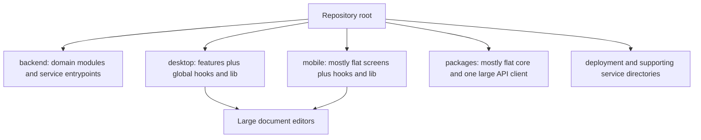
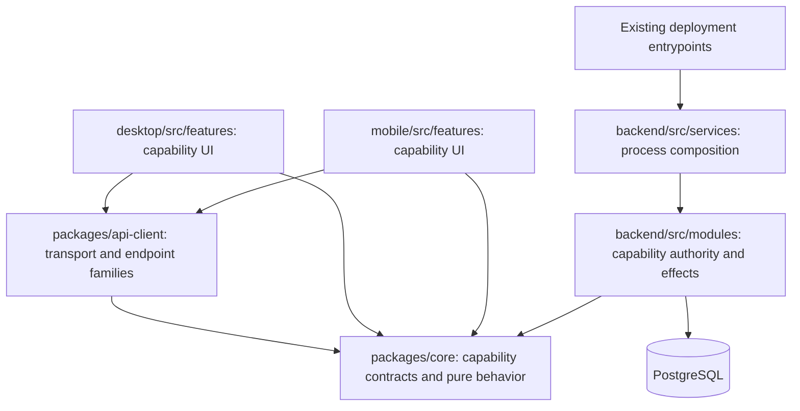

# Codebase organization by capability

**Status: IMPLEMENTED — local qualification complete.**

Date: 27 October 2026 (Australia/Melbourne).
Baseline: `1bc7e2c1af64d3ca70b609d499922f54bde68308`.
Task branch: `refactor/codebase-organization`.

## Decision

Keep the existing npm workspaces, runtime services, database and public contracts.
Organize implementation around the capability it owns, consistently across web,
mobile, backend and shared packages. Make the repository navigable through a
cross-stack owner map in the maintained architecture guide.

The user authorized this ADR and its implementation together. Completion means
the changes below exist and their affected consumers have been checked. It does
not mean publishing, merging or deploying this branch.

## Current structure and problem

The boundaries between deployments are useful. Navigation inside them is uneven:
mobile screens are mostly flat while web uses features; related document files
sit in broad directories; `task`/`tasks`, `assist`/`assistant` and
`publish`/`publishing` require inspecting implementations to distinguish owners.
The API client combines transport and many endpoint families. Shared core has
175 TypeScript source files distributed mostly at one level. Large editor and
shell files make local changes harder to locate. File size is a discovery signal,
not evidence of a correctness defect.

## Target ownership

- Both clients group screens, feature components and feature-specific helpers by
  capability. Shell composition stays in `app`; reusable visual primitives stay
  in `components`; platform infrastructure remains separate.
- Documents use explicit editor, library, source, collaboration and metadata
  responsibilities where real callers support those groups.
- Backend domain modules retain routes, service logic and authorization together.
  Names distinguish public page delivery from admin social publishing.
- Core implementation lives in named domain directories. Its root public export
  remains compatible; application code does not import other applications.
- API transport owns authentication, timeout, retry, cache and errors. Endpoint
  families own paths and typed methods. Existing `OrbynClient` callers remain valid.
- Deployment entrypoints and separately operated services retain their runtime
  identities. Operational paths move only when all repository-owned consumers can
  be migrated and the Compose/build wiring can be checked.
- No package per feature, new monorepo framework, duplicated shared state or
  generic forwarding layer is introduced just to create folders.

## Import and compatibility contract

The package entrypoints `@orbyn/core` and `@orbyn/api-client`, exported symbols,
HTTP paths, database schema, persisted storage keys, worker names and environment
variables keep their behavior. Internal relative imports move with their owner.
Application shells compose features; features use shared contracts and explicit
cross-feature interfaces. Internal helpers are not automatically public because
they sit beside a component. Core does not import API-client or application code;
API-client does not import application code. Native adapters retain platform
dependencies rather than moving them into shared core.

## Alternatives

Documentation alone would help discovery but leave the flat mobile and shared
implementation unchanged. Moving everything into one cross-stack feature package
would blur deployment/platform boundaries and add build complexity. A complete
rewrite of editors or shell state would combine behavioral risk with structural
work. Instead, move controlled callers mechanically, then extract coherent
responsibilities without redesigning behavior.

## Phases and acceptance

1. **Map ownership and controlled moves.** Inventory source/import/path consumers;
   establish the cross-stack map; make client feature names consistent and group
   shared domain implementation. Retire obsolete internal paths once every known
   caller is migrated.
2. **Document editor responsibilities.** Group document files consistently across
   clients and extract coherent pieces from large editors. Preserve selection,
   comments, mode conversion, preview, download and collaboration contracts.
3. **Assistant, tasks and projects.** Apply the feature convention to their client
   screens and helpers; clarify ambiguous names. Keep orchestration and permissions
   at their current runtime owners.
4. **Shared and operational boundaries.** Separate typed endpoint families from
   HTTP transport, organize core domains, and reconcile tooling/operational paths.
   Preserve package exports and deployment behavior.
5. **Qualify and reconcile documentation.** Check package consumers, maintained
   links, scripts and runtime build boundaries; review the complete diff and update
   this ADR with results and remaining limits before claiming completion.

## Designated gates and preservation

Feature checkout: `repo/orbyn-wt/codebase-organization`. Affected consumers are
core, API-client, backend, web/Electron and Expo. No schemas or dependencies are
intentionally changed. Build core/API-client, run all affected workspace type
checks, build web/backend, and export Expo bundles when dependencies/resources
permit. Check maintained documentation, formatting, import/path integrity and
any changed Compose configuration. The user explicitly authorized focused regression tests on 27 October 2026.
Run the changed consumer unit fixtures plus request/transport, editor loading and
source-boundary regressions. These checks use synthetic data and no live provider.

Widen evidence if extraction changes lifecycle behavior, exports, generated
inputs, dynamic imports or deployment references. Existing hosted required checks
remain binding for any later authorized PR. No production database, provider,
native hardware or deployed-release qualification is claimed by local checks.

Private `.env.production` stays in the primary checkout, ignored and untracked;
it is not copied to this worktree. Existing architecture worktree output and the
outer library's `.freebuff/` are unrelated and remain untouched. Changes stay in
one isolated worktree; no shared skill installation or public chat is created.

## Implementation and evidence

Implemented:

- 520 controlled source moves align client features and shared core domains.
- Document dispatch/loading is separated from legacy block editing on both clients.
- 615 endpoint implementations live in 17 named API families behind the compatible
  `OrbynClient` surface. Facade methods retain receiver binding and argument shape;
  the explicit compatibility forwarding costs repeated signatures, but avoids
  dynamic prototype installation or a breaking caller migration.
- Feature-specific mobile components now live with Assistant, home, planner,
  tasks, projects and other capabilities; both clients keep navigation chrome in
  `app/chrome`. Browse is shell navigation, model controls belong to Settings,
  and shared design tokens live under `core/src/theme`.
- Public document delivery and admin social publishing have distinct backend names.
- The maintained architecture guide maps each capability across the stack.
- A dependency-free source check validates retired paths, literal imports and
  cross-layer restrictions; synthetic fixtures cover positive and negative cases.
- Scoped ignore rules keep native-adapter Gradle and retained-fixture NuGet caches
  out of source diffs. Live editor-generated output is preserved and excluded.

Operational paths were traced and deliberately retained: Compose, Docker contexts,
deployment scripts and externally useful service identities already give these
folders operational owners. Grouping them into a new directory would add path
churn without improving feature discovery. The code map explains those boundaries.
Common core item/account schemas and types also retain their canonical owner;
this change does not distribute one schema among several competing owners.

### Qualification record

The source-equivalence audit compared 503 moved TypeScript files and the two
extracted legacy editor bodies against the baseline, normalizing only imports,
type-import targets and formatting. It also compared the bodies and parameters
of all 615 extracted endpoint functions. There were no unexpected expression
changes. The old/new public client declarations are assignable in both directions.
Separate-process export inventories preserve all 1,603 core and 41 API-client
runtime export names.

Initial checks exposed stale dynamically constructed fixture paths and mock keys.
A structural audit also found that an early move helper had treated non-path dot
literals as paths. Those changes were restored; permanent regression cases cover
decimal durations, legal versions, host segments, invisible math delimiters,
hidden files and current/parent import paths. Final evidence is gathered after
these corrections; earlier successful runs are not substituted for it.

| Gate                                                                                                  | Final local result                                                        |
| ----------------------------------------------------------------------------------------------------- | ------------------------------------------------------------------------- |
| Shared packages: `npm run build:packages`                                                             | Passed                                                                    |
| Backend: `npm run build -w backend`                                                                   | Passed; includes TypeScript                                               |
| Web/Electron renderer: `npm run build -w desktop`                                                     | Passed; includes TypeScript, Vite and homepage prerender                  |
| Mobile: `npm run typecheck -w mobile`                                                                 | Passed                                                                    |
| Renderer inputs: `npm run build:diagrams -w mobile`                                                   | Passed                                                                    |
| Expo: iOS and Android `expo export` from `mobile/`                                                    | Passed on the frozen source layout                                        |
| Unit and focused integration contract suite                                                           | 2,859 passed; zero failed, cancelled or skipped across 303 selected files |
| Generated MCP catalog and distribution output: generator plus `mcp-catalog.test.ts`                   | Regenerated; 4 tests passed                                               |
| CI/preflight/source guard fixtures: `.github/tests`                                                   | 31 passed                                                                 |
| Maintained guide links, code organization, indexed workspace boundary, retained-tool source integrity | Passed                                                                    |
| `npm run format:check` and diff whitespace checks                                                     | Passed; final ADR formatting is rechecked at completion                   |

The consumer suite selects every `backend/tests/*.unit.test.ts`, plus the pure
quick-add/recurrence contracts, legal integration and service-path authority checks.
Database-backed cases use only an owned disposable PostgreSQL 17 instance, a
separate `_test` database and the server-side `orbyn.environment='test'` marker.
No production configuration is loaded. The database is removed after qualification.
Generated catalog/distribution output is checked through its existing generator.

The CI selection job runs the new code-organization check alongside existing source
guards; no new workflow, required status name or deployment path was introduced.
Required hosted statuses apply to a later authorized PR. Hosted CI, production
rollout, native-device interaction and performance measurements are not claimed.
The web build retains its bundle-size advisory. The legacy editors and common
schemas are still substantial files, with explicit responsibility and navigation;
this decision does not claim that every future refactor has been exhausted.

### Completion audit

| Phase                               | Evidence                                                                                                                                                                           |
| ----------------------------------- | ---------------------------------------------------------------------------------------------------------------------------------------------------------------------------------- |
| Ownership and controlled moves      | Cross-stack code map; 520 detected renames; retired-directory and import checks pass                                                                                               |
| Document editor responsibilities    | Both clients group editor/source/library/collaboration/metadata/history; format loading is separate; loading, selection, mode and workspace regressions pass                       |
| Assistant, tasks and projects       | Feature screens/helpers/components are co-located; task/task-list names and shell navigation are explicit; both clients type-check and bundle                                      |
| Shared and operational boundaries   | Core domains and theme have canonical owners; 17 endpoint families retain the public client surface; runtime exports and declarations match; operational entrypoints remain stable |
| Qualification and maintained guides | 2,859 consumer checks and 31 policy fixtures pass; builds, source integrity, formatting and guide checks pass                                                                      |

All five phases are implemented and locally qualified. The implementation stays
on `refactor/codebase-organization`; publication, hosted CI, merge and deployment
are separate actions. No production configuration or unrelated workspace work is
part of this patch.
Recover by reverting the owned structural patch; no data migration is involved.
