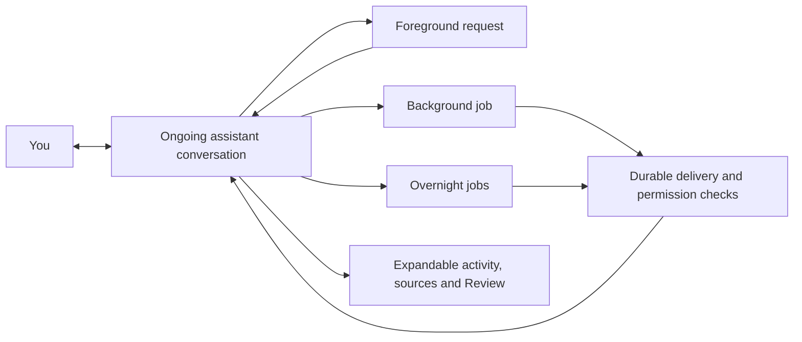

# One ongoing assistant conversation for Background and Overnight

**Status: ACCEPTED — implemented and locally qualified; rollout remains disabled.**

Research date: 21 October 2026, Australia/Melbourne. Source checkout: `main`,
`db4eb64956cf7cbdeebc468d459c1deae2856440`, with unrelated policy/skill edits
already present. The user accepted the recommended defaults and authorized full
implementation. The research receipt below records the earlier research stage;
it does not establish implementation or verification. Final implementation evidence and limits
are recorded in [the implementation ledger](unified-assistant-implementation.md#final-acceptance-audit--21-october-2026).

## What this means for the person using Orbyn

You talk to one personal assistant in an ongoing conversation. Work started
there can continue while you ask something else. When Background finds something
useful or Overnight finishes its work, the same assistant brings back a concise
update with sources and a way to inspect the work. You can reply to that update.

Background and Overnight remain real execution modes with their own jobs,
permissions, budgets and controls. Their current screens become activity and
review views reachable from the conversation. Users should not need to discover
a separate chat for each automated run to understand what happened.

“Same session” means continuity of conversation, assistant identity and relevant
context across app restarts and devices. It does not mean one endless model call,
one shared execution lock, or every project and private source entering every run.
Ordinary project conversations remain separate. The personal conversation is the
default home for personal proactive findings; explicitly requested work returns
to its originating conversation unless the person chooses another permitted
destination.

Fictional examples:

1. At 4 pm you ask, “Compare three venues overnight.” You then discuss tomorrow's
   tasks in the same conversation. At 8 am the assistant says, “Two venues fit
   your budget. One price is unconfirmed,” with sources and an expandable result.
   Replying to that update with “Check the second one's availability” targets the
   venue work, even if another job has finished since then.
2. A background check finds a changed deadline. The assistant posts one sourced
   update in the personal conversation. Tomorrow's unchanged check stays quiet.
3. Work started in a project conversation reports there. It does not copy the
   project result into the personal inbox merely because both belong to you.
   A personal notification can link to it without exposing its content.
4. Overnight needs approval to change a plan. The conversation shows the request
   and opens the existing Review controls. “Looks interesting” is conversation,
   not approval to apply a change.

## Evidence and confidence

### Reference behavior: observed and documented

The user-supplied Dots screenshot was inspected. It shows a named assistant's
conversation containing dated proactive updates, source links, a reply composer,
and a profile/activity/output panel. It does not show how messages were scheduled,
stored, deduplicated, authorized or delivered. Private screenshot text is omitted
from this record.

Official pages were opened, and the three Learn pages were also fetched through
the official documentation tool on the research date:

| Source                                                                                                      | Documented behavior relevant to this decision                                                                                                                                                                                                                                                                                                                    |
| ----------------------------------------------------------------------------------------------------------- | ---------------------------------------------------------------------------------------------------------------------------------------------------------------------------------------------------------------------------------------------------------------------------------------------------------------------------------------------------------------- |
| [Tasks and memory](https://learn.chatgpt.com/docs/dots/tasks-and-memory)                                    | A conversation coordinates multiple responsibilities while parallel background agents work. Delegated tasks have scoped context and their own conversations. Saved schedules specify timing, notification conditions and destinations. Proactive research reports findings to the dot. Visible channel conversations and disclosure permissions remain distinct. |
| [Control your dot](https://learn.chatgpt.com/docs/dots/controls)                                            | Activity exposes work and decisions. Pausing the main task, stopping a delegated task and canceling a schedule have different effects. Existing permissions and action review still apply.                                                                                                                                                                       |
| [Get started with your dot](https://learn.chatgpt.com/docs/dots/getting-started)                            | The same dot continues across devices; users can keep talking while responsibilities progress.                                                                                                                                                                                                                                                                   |
| [Getting started with your dot](https://help.openai.com/en/articles/20001530-getting-started-with-your-dot) | Conversation replies can steer work; a profile exposes activity and results.                                                                                                                                                                                                                                                                                     |

**Inference:** the useful pattern is a coordinating conversation with inspectable
execution, rather than flattening all execution into one model session. The
sources describe a product contract, not proprietary backend implementation.
Orbyn's durable-delivery design below is our proposal.

### Shipped-client inspection: manual static analysis, not an REA run

No REA MCP tools were present in the active catalog; `command -v rea` found no
executable; `tools/rea/dist` and `tools/rea/node_modules` were absent. The pinned
source is package 6.7.0. The repository tooling policy and upstream connection
recovery guide were read. No packages were installed, runtime built, provider
registered or application launched. A later REA pass would first require an
explicitly scoped pinned local build/setup; it is not necessary to review this
proposal. No REA Evidence IDs exist for this research.

A small read-only Python reader inspected ASAR header JSON and selected member
bytes. Prefix extents were checked against the format described by
[`AsarHeader.ts`](../../tools/rea/src/artifacts/AsarHeader.ts). Offsets below are
zero-based decoded-text character offsets in the named minified members, not
binary addresses. These observations are reproducible from the archive hashes:

| Artifact                     | Identity and SHA-256 of `Contents/Resources/app.asar`                                                         |
| ---------------------------- | ------------------------------------------------------------------------------------------------------------- |
| `/Applications/ChatGPT.app`  | `com.openai.codex`, 26.1013.40934 / 20770; `5ddc4e48259aa6f979e04529b1a5a4ae54b0f5c4ad6db5c6e004924c10916ddb` |
| `/Applications/Grok Bot.app` | `com.anysphere.sand`, 0.18.0 / 0.18.0; `6665408168466f9cacc6087e917890c17f59d2e2e9c2404a5c4a59ad79c1de58`     |

| Selected shipped member                                                             | Static observation                                                                                                                                | Limit                                                                                                        |
| ----------------------------------------------------------------------------------- | ------------------------------------------------------------------------------------------------------------------------------------------------- | ------------------------------------------------------------------------------------------------------------ |
| ChatGPT `webview/assets/companion-tab-632ab105ad2f.js`, around 79823                | Task projection includes `automationId`, `conversationId` from `conversation_id`, `lastPublishedRunAt`, last-run status and a needs-action field. | Establishes client task/conversation linkage; not server scheduling or exactly-once delivery.                |
| ChatGPT `webview/assets/configuration-schedule-f64e81057e7e.js`, around 14437–14701 | Heartbeat configuration uses `targetThreadId`; destination control describes running in a new or existing task.                                   | This is local automation UI, not proof that all dot research uses this mechanism.                            |
| ChatGPT `webview/assets/chatgpt-conversation-runtime-29e5a4534244.js`, around 4056  | Client checks a conversation stream-status endpoint and has a background polling path.                                                            | Does not establish proactive orchestration; foreground streaming can also need recovery polling.             |
| Grok `dist/renderer/assets/index-UbX-y3il.js`, around 3687051 and 3688792           | Generated message constructors include subagent IDs/types, `parentConversationId`, parallel-worker/status fields and execution counters.          | Supports a parent/subagent representation, not a proven proactive inbox behavior or dispatch implementation. |

The bounded Grok search of that renderer member found no literal `scheduledTask`,
`scheduled_task` or `proactive`. That is not evidence the product lacks scheduling.
Muse was not identified as a separate authorized artifact and was not inspected.
ChatGPT Classic was not used as a substitute for the identified Dots client.
No credentials, cookies, conversation stores, live traffic or personal app data
were accessed. No live agent actions or messages were triggered.

### Current Orbyn: source-derived behavior

These are current-source findings, not runtime qualification:

| Owner / source                                                                                                                                                                                                                                                                                                     | Relevant mechanism and consequence                                                                                                                                                                                                                |
| ------------------------------------------------------------------------------------------------------------------------------------------------------------------------------------------------------------------------------------------------------------------------------------------------------------------ | ------------------------------------------------------------------------------------------------------------------------------------------------------------------------------------------------------------------------------------------------- |
| [`startAssistantAutomation`, `run.ts`](../../backend/src/modules/ai/agent/run.ts)                                                                                                                                                                                                                                  | Creates fresh chat/turn UUIDs, calls `beginChatTurn` with `scope: null`, and inserts a queued `ai_jobs` row with automation origin. Task, goal, routine and night workers call it. Automation results therefore have their own execution chats.   |
| [`routes.ts`](../../backend/src/modules/ai/routes.ts), assistant submission                                                                                                                                                                                                                                        | Serializes submission with a per-user/chat advisory transaction lock; reuses matching submission keys; rejects a new turn when the chat has a queued, running or waiting job. Reusing one `chat_id` for all jobs would block normal conversation. |
| [`chats.ts`](../../backend/src/modules/ai/chats.ts)                                                                                                                                                                                                                                                                | Server-owned history, row-locked turn writes and completion deduplication by turn ID. Saved turns are capped at 200; request history selects the last 12. This is not an unlimited assistant timeline.                                            |
| [`run.ts`](../../backend/src/modules/ai/agent/run.ts), `finishJob` / `waitFor`; [`lease.ts`](../../backend/src/modules/ai/agent/lease.ts)                                                                                                                                                                          | Job completion, chat answer and notice intent are coordinated transactionally; waiting questions have identities; lease ownership fences completion. Preserve this recovery model.                                                                |
| [`runtime-lanes.ts`](../../backend/src/modules/ai/agent/runtime-lanes.ts)                                                                                                                                                                                                                                          | Interactive/background/overnight capacity is already separated. Conversation unification must preserve that isolation.                                                                                                                            |
| [`BackgroundView.tsx`](../../desktop/src/features/assistant/BackgroundView.tsx), [`AssistantView.tsx`](../../desktop/src/features/assistant/AssistantView.tsx), [`OvernightView.tsx`](../../desktop/src/features/assistant/OvernightView.tsx), [`OvernightSheet.tsx`](../../mobile/src/screens/OvernightSheet.tsx) | Background has an independent surface; outputs open `output.chat_id`. The assistant has lane navigation; Overnight exposes run results, decisions and execution-chat links.                                                                       |
| [`activity.ts`](../../backend/src/modules/assistant-workspace/activity.ts), [`profiles.ts`](../../backend/src/modules/assistant-workspace/profiles.ts), [shared activity schema](../../packages/core/src/assistant-activity.ts)                                                                                    | Owner/lane cursor feeds are content-free and access-filtered. Profiles expose outputs. Reuse activity for details; it is not a durable conversational message feed.                                                                               |
| [`notices.ts`](../../backend/src/modules/ai/agent/notices.ts), [`overnight-notices.ts`](../../backend/src/worker/overnight-notices.ts)                                                                                                                                                                             | Person-origin away notices use durable intents, a grace period and unique conflict handling. Overnight owns a morning notice/card and refreshes it as late work settles. A new feed must not send duplicate alerts through both paths.            |
| [`assistant-visibility.ts`](../../backend/src/lib/assistant-visibility.ts), [`assistant-job-sources.ts`](../../backend/src/lib/assistant-job-sources.ts), [`handoffs.ts`](../../backend/src/modules/assistant-workspace/handoffs.ts)                                                                               | Current access depends on owner, scope and recorded sources. Handoffs check receiving authority/rules. A delivery destination is not permission to copy source content or execute another action.                                                 |

## Proposed decision

Adopt **durable conversation-linked delivery**. Keep the existing PostgreSQL job,
lease, proposal/Review and runtime-lane architecture. Add a personal assistant
conversation mapping and an authorized timeline with durable update identities.
Do not replace custom orchestration with a framework.

| Option                                        | Benefit                                                                                                                 | Problem / decision                                                                                                                                                           |
| --------------------------------------------- | ----------------------------------------------------------------------------------------------------------------------- | ---------------------------------------------------------------------------------------------------------------------------------------------------------------------------- |
| UI-only aggregation of current chats/activity | Small initial UI change; retains current execution.                                                                     | No stable delivered update/reply identity, shared unread state, durable suppression or reliable offline ordering. Useful as a prototype, insufficient as the final contract. |
| Put every run in the same execution chat      | Appears to reuse existing chat storage.                                                                                 | Conflicts with the active-run guard, mixes histories and source dependencies, and makes cancellation ambiguous. Reject.                                                      |
| Durable delivery separate from execution      | Stable updates, targeted replies, recovery, permission checks and cross-device read state; existing jobs stay isolated. | Requires a schema/feed and careful integration with chat history and notifications. Recommend.                                                                               |

### Data ownership and interfaces

Names below are proposed contracts, not existing APIs or final SQL names.

| Record                        | Owner and invariant                                                                                                                                                                                                                                                                                                                             |
| ----------------------------- | ----------------------------------------------------------------------------------------------------------------------------------------------------------------------------------------------------------------------------------------------------------------------------------------------------------------------------------------------- |
| Personal conversation mapping | One active canonical personal `ai_chats` mapping per user, created transactionally on demand. Scope remains personal. A generation/tombstone prevents a deleted destination being silently recreated by a worker.                                                                                                                               |
| Work delivery binding         | Records `job_id` or maintained-page run ID, owner, origin conversation/turn if present, chosen destination/generation, reason and source references. Set at work admission or schedule creation, not guessed when work finishes. Execution `ai_jobs.chat_id` remains the job's execution chat.                                                  |
| Timeline entry                | Stable entry ID and per-conversation sequence; typed foreground turn reference or background/overnight update; work reference, event identity, revision, timestamps and per-entry provenance. A unique `(owner, work, event_key, destination_generation)` prevents replay duplicates. Night summaries use the night ID and their own event key. |
| Delivery intent               | Persisted in the state-transition transaction; states pending, deferred, published, suppressed or blocked with reason. An idempotent publisher leases/locks pending intents and rechecks permission before publishing. Completion is distinct from publication.                                                                                 |
| Read / alert state            | Per-user/conversation read cursor and separately deduplicated notification intent keyed to entry/event, never one unread flag per device. Alert receipts remain distinct from the timeline.                                                                                                                                                     |

The conversation service owns the ordered timeline; workers submit delivery
intents. Clients do not reconstruct or copy assistant answers from arbitrary job
payloads. Proposed operations: read a paginated authorized timeline; acknowledge
through a visible sequence; submit a message with optional `reply_to_entry_id`;
act on a versioned waiting request by job/waiting ID. Shared Zod contracts belong
in `packages/core`; transport and recovery state belong in `packages/api-client`.

For foreground turns, timeline entries reference the existing saved turn identity;
they do not create another independently editable answer. All new foreground
turn appends and their timeline references commit together through the chat owner.
Execution chats keep their current checkpoint/history representation initially.
The timeline must outlive the current 200-turn window: persist its displayable
foreground payload/provenance before truncation, under the same owner and
transaction. An unbounded personal timeline cannot rely solely on references to
turns that `chats.ts` later removes. Define retention/deletion before enabling it.

### Routing and context

An explicit request in the canonical conversation returns there. An explicit
request in another conversation returns to that origin. Schedules save their
destination, time zone and interruption policy. Proactive personal research
without an origin uses the canonical personal conversation only when its grant
permits the research and the receiving conversation may disclose the result.
Cross-space summaries require explicit permitted routing; shared/team delivery
and new messaging channels are outside this decision.

Read the destination and every source again at publication, display, reply,
context construction and effect execution. Ownership alone is insufficient.
Legacy jobs without trustworthy provenance cannot be auto-published. Do not copy
the union of all background source dependencies onto the canonical chat:
`assistantChatVisible` currently hides an entire chat on a revoked dependency.
The new timeline must filter dependent entries individually while retaining the
rest of the conversation. Existing scoped execution chats keep their checks.

Provider context is a bounded selection of currently authorized foreground turns,
the replied-to update and relevant work summaries. It is not the full timeline or
all workers' private reasoning. Preserve source references for derived replies and
memory notes too; otherwise a once-authorized quotation could leak after access
is revoked. Context already sent to a provider cannot be recalled; subsequent
requests must filter it, and pending runs/effects must revalidate authority.

### Concurrency and replies

Keep the active-run guard for each execution chat. A foreground conversation can
have one interactive request while multiple background jobs run in their own
execution chats. Publishing a result is a short database operation, not another
interactive model run. Do not reserve the canonical chat's active slot merely to
deliver an update. Preserve separate lane capacities, budgets and admission.

Snapshot authorized context at foreground submission. A concurrently arriving
update appears as a separate timeline entry and cannot mutate a streaming answer
or its context in place. Order by committed sequence; show work completion time
separately when delivery was delayed. Ordinary simultaneous foreground sends
retain the current conflict/retry contract initially.

Reply chips carry stable entry IDs. The server resolves the exact work and source
scope. A clarification starts a new foreground turn linked to that update;
“continue this work” starts an authorized follow-up job. An answer to a waiting
question uses its current job/waiting ID and existing resume path. Applying a
proposal uses existing Review/version checks. Stale or resolved questions explain
their state and cannot resume another job. Ambiguous plain-text replies ask which
work item they refer to; never silently target the latest completed job.

### Delivery, attention and controls

Publish useful results, material changes, actionable failures and requests for a
decision. Repeated unchanged scans, empty runs and routine progress stay in
activity. Use a stable source/change fingerprint to suppress no-ops, with the
reason recorded; a model-written summary alone is not a deduplication key.

Proposed default: non-urgent background findings wait for the person's configured
delivery window; Overnight posts one morning summary, with expandable per-run
results. Late work revises that summary without another push unless it introduces
a new decision or material failure. Normal foreground responses stay immediate.
Quiet hours use the person's time zone and DST. No urgent exception is enabled
without an explicit policy. A permanently blocked provider/run should generate
one actionable failure update rather than repeated failure spam.

An entry becomes unread when published. Mark it read only when displayed in the
active conversation and acknowledged, not on background fetch, polling or opening
another device. Push/in-app notifications link to the entry; hide sensitive body
content by default. One notification owner chooses whether the existing away or
morning path is replaced for a migrated event. Do not parallel-send both paths.
Notification processing must recheck authorization and quiet hours; OS push
delivery is best effort, distinct from exactly-once timeline publication.

Controls should name their actual scope:

| Control               | Proposed effect                                                                                                                                                                                                                              |
| --------------------- | -------------------------------------------------------------------------------------------------------------------------------------------------------------------------------------------------------------------------------------------- |
| Stop this work        | Requests cancellation of the identified job through the existing lease/checkpoint path. Preserves its history and completed effects. Does not cancel a schedule.                                                                             |
| Pause background work | Prevents new background admissions; in-flight work reaches a safe checkpoint and pauses where supported. It does not disable foreground chat or delete schedules. Unsupported in-flight pause must be shown accurately, with Stop available. |
| Pause Overnight       | Prevents further night admissions; exposes currently running work and its separate Stop control.                                                                                                                                             |
| Pause/cancel schedule | Prevents future occurrences; does not implicitly stop an already admitted job. Offer an explicit combined action if needed.                                                                                                                  |
| Mute updates          | Changes alerts/delivery timing only; does not authorize, pause or cancel execution.                                                                                                                                                          |

These are proposed Orbyn semantics, not a claim to reproduce Dots' Pause behavior.
Closing the conversation has no execution effect. Global grant revocation follows
existing authorization rules and blocks further effects and delivery.

### Recovery, deletion and compatibility

Completion and its delivery intent commit together under the existing lease fence.
A crash before commit leaves neither; after commit the publisher can retry.
Publishing the entry and marking its intent published must be atomic. Unique
event keys and expected revisions prevent duplicate entries and stale summary
overwrites. Notifications are queued from published entries with their own unique
keys; network retries must not rerun the underlying work. Existing apply receipts
remain authoritative for effects.

If source access is revoked, block pending content publication and hide dependent
published entries/derived context on subsequent reads. Clear corresponding local
caches on refresh and use private/no-store responses; an offline device cannot
be guaranteed to forget already viewed text. Use a neutral unavailable state when
needed, without leaking source titles. Do not hide the whole personal timeline.

If an origin/destination chat is deleted or swept into a summary, do not resurrect
it or silently redirect its private result. Block delivery, retain only permitted
audit metadata, and require a new explicit destination. Deleting the personal
conversation tombstones its generation and cancels pending deliveries to it.
Explain separately which jobs/schedules continue, and offer explicit Stop/cancel
choices; deletion must not suggest completed effects were undone. A future
interactive creation can establish a new generation; workers cannot do so.

Keep historical execution chats and URLs intact. New work opts into bindings
after the feature flag is enabled. Do not bulk-copy historic private results or
mark old work unread. Offer bounded, user-selected history links after current
permission checks. For active jobs admitted before rollout, finish through the
existing delivery path unless a transactional, deduplicated binding migration is
explicitly designed. Maintain old client endpoints during rollout.

Rollback disables new bindings and timeline publication, restores existing lane
surfaces/notification ownership for newly admitted work, and preserves jobs,
receipts and already published entries. Pending bound intents stay parked rather
than being replayed through legacy alerts. Forward re-enablement reuses the same
keys. No destructive schema rollback or history rewrite is required.

## Staged implementation plan

The lead owns integration and review. A named Backend/Domain Builder owns the
coupled schema/runtime work; a Client Builder can follow once contracts stabilize.
Use the repository's current model/coordination policy at execution time. These
stages do not authorize tests, deployments or new chats by themselves.

| Stage / owner                                                                     | Concrete files and outcome                                                                                                                                                                                                                                           | Dependencies / completion evidence to obtain later                                                                                                                                                               |
| --------------------------------------------------------------------------------- | -------------------------------------------------------------------------------------------------------------------------------------------------------------------------------------------------------------------------------------------------------------------- | ---------------------------------------------------------------------------------------------------------------------------------------------------------------------------------------------------------------- |
| 1. Domain and storage — Backend/Domain Builder                                    | New migration under `backend/migrations/`; new shared conversation/delivery schema in `packages/core/src/`; integrate `project-chats.ts`, `assistant-workspace.ts`. Define mapping/generation, bindings, per-entry provenance, sequences, retention and unique keys. | Resolve retention/control defaults. Review transaction boundaries, deletion and current client compatibility.                                                                                                    |
| 2. Durable delivery — same Builder                                                | `backend/src/modules/ai/agent/run.ts`, `chats.ts`, `routes.ts`; new conversation delivery module under `assistant-workspace`; worker task/goal/routine/idea/night entry points, including maintained-page runs. Preserve leases, lane isolation, budgets and Review. | Stage 1. Demonstrate admitted origin/destination, atomic intents and replay-safe publication. Do not repoint every `ai_jobs.chat_id`.                                                                            |
| 3. Authorized feed and replies — same Builder                                     | `backend/src/modules/assistant-workspace/{activity,profiles,overnight}.ts`, visibility/source helpers and conversation routes; `packages/api-client/src/` feed/recovery client. Integrate memory/context selection.                                                  | Stage 2. Paginated stable feed, per-entry visibility, explicit replies/waiting actions and read acknowledgements. Existing content-free activity stays separate.                                                 |
| 4. Conversation UI — Client Builder                                               | `desktop/src/features/assistant/{AssistantView,BackgroundView,OvernightView}.tsx`, `desktop/src/hooks/useAssistant.ts`; `mobile/src/hooks/useAssistant.ts`, `mobile/src/screens/OvernightSheet.tsx` and owning assistant screen.                                     | Stage 3. One default personal conversation, inline updates/reply targets, expandable activity and Review; keyboard/scroll/stream behavior reviewed on changed flows. Native checks need separate scope.          |
| 5. Attention and rollout — Backend/Domain + Client Builders, serialized ownership | `backend/src/modules/ai/agent/notices.ts`, `backend/src/worker/overnight-notices.ts`, existing notification routing; client badges/deep links; owning product guides.                                                                                                | Stages 2–4. One alert owner, quiet-window/no-op policies, old-client behavior, feature flag and rollback receipt. Inspect existing channel outboxes to avoid duplicating alerts without expanding channel scope. |

### Acceptance cases — completion requires direct evidence

1. Foreground chat remains usable while two independent background jobs run; an
   update arriving during streaming does not replace the answer or block sending.
2. Completion followed by worker/publisher crash and replay yields one timeline
   update and one logical notification intent, with no repeated applied action.
3. Two completed jobs and two waiting questions can be replied to individually;
   stale IDs cannot approve or resume the wrong work.
4. Origin-scoped work returns to its origin; an unsolicited personal finding uses
   only its authorized personal destination. No team/private content is copied
   by fallback routing.
5. Access revoked before publication, after publication and before a reply removes
   dependent content/context while unrelated conversation remains usable.
6. Empty/unchanged checks stay quiet; quiet hours and DST defer non-urgent delivery;
   the morning summary absorbs late work without duplicate pushes.
7. Two devices agree on unread state after acknowledgement. Refresh/reconnect and
   timeline pagination preserve order, reply IDs and foreground content older
   than the current 200-turn execution-history window.
8. Stop affects the chosen job; pause prevents new admissions; cancel schedule
   prevents future occurrences. History and completed effects remain truthful.
9. Deleted/swept destinations are not recreated or silently rerouted. New personal
   conversation generations cannot receive old pending deliveries.
10. Maintained-page results, provider failures, disabled accounts, unknown legacy
    provenance and grant revocation follow the same delivery authority contract.
11. Rollout with old clients and active legacy jobs does not duplicate history or
    alerts; rollback/re-enable preserves work and delivery idempotency.

## Decisions for review and exclusions

### Mobile reference clarification — 21 October 2026

The two additional user-supplied mobile screenshots show the named main assistant
(“God” in that account) above pinned/recent conversations, one dated conversation
for proactive messages and replies, and a compact composer. In Orbyn this maps to
the person's named Orbyn assistant and canonical personal conversation. Background
and Overnight remain inspectable work/activity views that deliver into that
conversation; they are not competing default conversations. The mobile drawer
should expose the main assistant first and avoid repeating it in history. Use
Orbyn's existing tokens and accessible controls. The pictured call/voice control
does not expand the implementation scope. No private screenshot message text is
copied into this record, and screenshots do not establish backend behavior.

Accepted defaults: one canonical personal conversation;
origin-first routing; a morning Overnight summary; no-op suppression; quiet-hour
deferral; per-entry permission checks; explicit targeted replies; historical work
linked on demand.

Implementation defaults: retained history has no automatic age expiry and is
exported under current permissions until explicit deletion. A new canonical home
is created on demand; existing chats are not silently adopted or bulk imported.
Lane controls pause new admissions only. Already admitted work continues with
separate Stop controls; no in-flight checkpoint pause is promised. Global grant
suspension remains a distinct authority action. Existing reminder quiet windows
and the person's timezone own alert deferral. Background and Overnight remain
accessible as activity/review views rather than separate default conversations.
These decisions define the implementation contract, not completion evidence.

Excluded: cloud computers, voice, Slack/Teams expansion, unrestricted autonomous
actions, replacing orchestration, provider/model migration, unlimited context,
bulk history migration, native builds and deployment. Existing outward-facing
effects still require their current trust and recipient authorization.

## Research-only receipt — before implementation authorization

The fresh host exposes `agent_type` values `orbyn-agent` and `orbyn-light`, matching
the local Sol/medium and Luna/high definitions. Thus named-type selection is
available in the schema. However, the host's model inventory lists Priority as
the available service tier and exposes no standard-tier selector. No native
delegate was launched because standard processing could not be preserved from
that advertised contract. Effective child model/effort/speed is consequently
unverified. No generic-agent or hidden CLI substitute was used. The two independent
research slices (reference evidence and Orbyn ownership) were completed directly;
independent delegate separation remains unavailable under the speed constraint.

Evidence obtained: screenshot inspection; exact official page fetches; bounded
manual ASAR inventory/member reads with archive hashes; current source tracing;
local Markdown link/whitespace checks. No product runtime, test suites, security
scans or native checks were run. Proprietary server behavior, a full Muse/Grok
proactive-flow reconstruction and actual REA execution remain unverified.

Research-stage delivery was the local proposed ADR only. No product implementation, goal,
commit, push, PR, merge, publication or deployment was made. Existing unrelated
checkout changes were preserved. The user subsequently accepted the defaults and
authorized implementation; current progress and evidence are recorded in
[the implementation ledger](unified-assistant-implementation.md).
